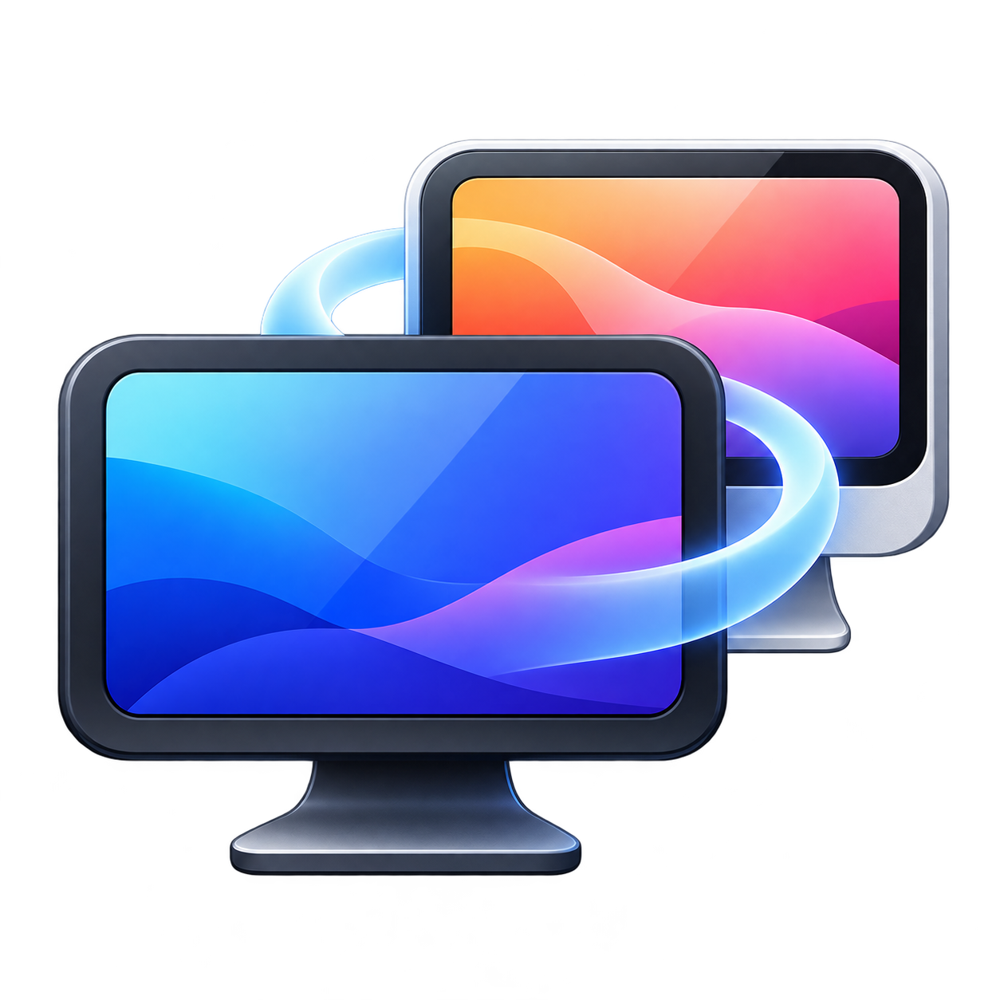

# Omascreen



Remote desktops that feel at home on Omarchy. Manage your connections in a native
GUI, give each computer its own app launcher, and connect to Macs using Apple's
High Performance protocol or to standard VNC servers using TigerVNC.

- Saved connections, searchable library, and per-connection app entries.
- High Performance Mac video, audio, clipboard, and keyboard/mouse input.
- Automatic Mac/VNC detection with a choice of connection mode.
- Online Mac artwork, Lucide icons, custom images, or the Mac's own icon over SSH.
- Packet-loss recovery and automatic High Performance reconnection after sleep
  or a broken connection.
- Native Qt settings and GLFW/wgpu viewer; follows the active Omarchy palette.

## Install

On Omarchy, install the system dependencies in a terminal:

```sh
omarchy pkg add uv git libfdk-aac portaudio vulkan-icd-loader wl-clipboard tigervnc avahi

git clone https://github.com/BuiltByTed/omascreen.git
cd omascreen
./scripts/install.sh
omascreen
```

You also need your GPU's working Vulkan driver. The installer keeps the app in
`~/.local/share/omascreen/venv`, adds `~/.local/bin/omascreen`, and creates the
**Omascreen** menu entry. It does not require root. The preceding system package
command may ask for authentication. See [installation and updates](docs/installation.md)
for other Linux desktops, optional dependencies, and the Arch/AUR/Omarchy packaging route.
Omascreen is **not yet published in AUR or the Omarchy package repository**.

## Your first connection

1. Open **Omascreen** and choose **Add connection**.
2. Enter a name, address, and (for Macs) the remote account name.
3. Leave the mode on **Detect automatically**, or select **High Performance (Mac)**
   or **Standard VNC**. Use **Detect Mac / VNC capabilities** to check now.
4. Choose an icon in the **Icon** tab and keep **Show this connection as an app
   in the Omarchy menu** enabled.
5. Save and click **Connect**. Afterwards, launch the connection directly by
   its name from the Omarchy application menu.

On a Mac, enable **System Settings → General → Sharing → Screen Sharing** and
allow your account. High Performance requires a compatible Apple silicon Mac
and macOS 14 or newer; the server confirms protocol availability during connection.
For Standard VNC on macOS, enable **VNC viewers may control screen with password**
if offered in Screen Sharing settings, and use that separate VNC password in
TigerVNC. Omascreen does not change the Mac's settings.

Use a trusted LAN or private network such as Tailscale; avoid exposing VNC directly
to the internet. Standard VNC security depends on the server's configuration.

## Command line

```sh
omascreen add 'Mac Studio' --host studio.local --user mac-user --shortcut
omascreen add 'Home server' --host server.local --protocol vnc --shortcut
omascreen list
omascreen connect 'Mac Studio'
omascreen edit 'Mac Studio' --fullscreen
omascreen detect 'Mac Studio'
```

The old `screen-sharing` command remains an alias, and existing connections and
keyring passwords are preserved.

## Documentation

- [Desktop GUI and the Omarchy app workflow](docs/gui.md)
- [CLI commands and examples](docs/cli.md)
- [Installation, updates, uninstalling, and packaging](docs/installation.md)
- [Icons, online sources, and attribution](docs/icons.md)
- [Troubleshooting and connection modes](docs/troubleshooting.md)
- [Protocol research](docs/apple_vnc_rfc.md)

## Development

```sh
uv venv .venv
uv pip install --python .venv/bin/python -e '.[test]'
QT_QPA_PLATFORM=offscreen .venv/bin/python -m pytest
```

The test suite covers packet reordering and loss recovery for AVC and HEVC,
suspend/timeout detection, reconnect process behavior, credentials, profiles,
launchers, the native editor, icon downloads, and credential-free RFB detection.
It uses fake network peers and processes; physical sleep/wake and real remote
servers require live testing. The low-level command also supports
`--headless --auto-quit-secs 30` for a short live protocol test.

## License

Code is AGPL-3.0-or-later, derived from
[renegadelink/iShareScreen](https://github.com/renegadelink/iShareScreen).
See [LICENSE](LICENSE), [NOTICE](NOTICE), and [artwork attribution](docs/icons.md).
Apple device images are downloaded into the user's local cache, never bundled
in the source or releases. This project is independent of Apple and Omarchy.
